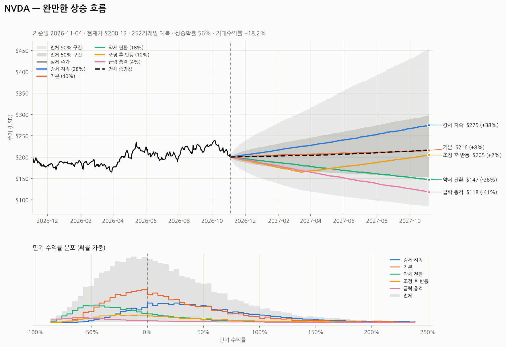

# STk — 미국 개별주 시나리오별 주가 흐름 예측

미국 단일 종목(AAPL, NVDA, TSLA …)의 과거 시세를 분석해 **강세 / 기본 / 약세 / 조정 후 반등 / 급락** 등
여러 시나리오를 자동으로 보정하고, 몬테카를로 시뮬레이션으로 **향후 주가의 전체적인 흐름**
(방향, 경로 모양, 변동 범위, 시나리오별 확률)을 예측하는 프로그램입니다.



## 설치

```bash
pip install -r requirements.txt        # numpy, pandas, requests, matplotlib
# 또는 명령어로 설치:  pip install -e .   →  stk AAPL
```

Python 3.10 이상. 시세는 Yahoo Finance에서 내려받고 `~/.cache/stk/` 에 12시간 캐시합니다.

## 빠른 시작

```bash
python -m stk AAPL                         # 6개월(126거래일) 예측
python -m stk NVDA -H 1y                   # 1년 예측
python -m stk AAPL MSFT NVDA TSLA -H 3m    # 여러 종목 + 비교표
python -m stk backtest AAPL -H 3m          # 과거 시점별 예측 정확도 평가
python -m stk scenarios > my.json          # 시나리오 설정 내보내기 → 수정 → --scenarios my.json
```

실행하면 콘솔에 리포트가 출력되고 `output/` 폴더에 차트(PNG), 마크다운 리포트(MD), 전체 결과(JSON)가 저장됩니다.

### 출력 예시 (요약)

```
■ 전체 흐름 전망
  ▶ 완만한 상승 흐름  —  꾸준히 우상향하는 경로
  · 상승 마감 확률 63%  |  기대수익률 +8.2%  |  중앙값 수익률 +6.8%
  · 만기 90% 범위 $259.93 ~ $511.88  |  변동성 높음 (90% 구간 폭 72%)
  · 기간 중 +20% 도달 확률 43%  |  −20% 도달 확률 18%  |  최유력 시나리오: 기본

■ 시나리오별 결과 (만기 2027-05-07)
     시나리오      확률  연 기대수익률     기대가격     중앙값      5%~95% 범위     상승확률  중앙 MDD
  강세 지속         36%         +27.2%  $400.18 (+14%)  $394.51  $298.87 ~ $520.47       76%      -13%
  기본              38%         +14.0%   $373.85 (+7%)  $367.03  $268.36 ~ $501.98       60%      -16%
  ...
■ 기간별 흐름 — 시나리오별 중앙값 가격 경로
  기간      날짜     강세 지속   기본    약세 전환  조정 후 반등  급락 충격   전체 중앙값     전체 25~75%
  1개월  2026-12-04    $356.99  $352.17    $347.86       $342.12    $341.12  $352.72 (+1%)  $333.60~$372.32
  3개월  2027-02-05    $371.59  $358.42    $344.81       $339.92    $323.74  $360.36 (+3%)  $326.57~$395.31
  ...
```

리포트 구성:

1. **전체 흐름 전망**: 확률가중(혼합) 분포 기준 방향 판정(뚜렷한/완만한 상승·횡보·하락), 경로 모양
   (우상향 / 조정 후 회복 / 상승 후 되돌림 등), 90% 범위, ±20% 도달 확률
2. **현재 상태 진단**: 추세 점수, 이동평균, RSI, 모멘텀, 변동성(현재/1년/장기), 베타, 꼬리 두께, 기대수익률 보정 내역
3. **시나리오별 결과**: 확률, 기대가격, 중앙값, 5~95% 범위, 상승확률, 경로 중 최대낙폭(MDD) 중앙값
4. **기간별 흐름**: 1주·1개월·3개월·6개월·1년 시점의 시나리오별 중앙값 가격과 전체 분포

## 모델 구조

```
시세 수집 ─▶ 상태 진단 ─▶ 파라미터 보정 ─▶ 시나리오 구성·확률 배정 ─▶ 몬테카를로 ─▶ 혼합 분포·흐름 판정
(Yahoo)     (analysis)   (calibrate)      (scenarios)                 (simulation)  (forecast/report)
```

| 단계 | 내용 |
|---|---|
| 상태 진단 | 수정종가 기준 변동성(EWMA·1년·5년), 6개월/1년 로그가격 회귀 추세, 20/50/200일 이동평균, RSI(14), 12-1개월 모멘텀, SPY 대비 베타, 표준화 수익률 첨도로 추정한 꼬리 두께 |
| 추세 점수 | 200일선 위치(25%) · 50/200일선 크로스(20%) · 12-1 모멘텀(25%) · 6개월 추세 t값(20%) · RSI 과열/과매도 역추세(10%)를 각각 −1~+1로 정규화해 가중평균 |
| 기본 기대수익률 | `(1−w)·CAPM + w·최근 추세`, CAPM = 무위험이자율(13주 T-bill) + β × 주식위험프리미엄(5%), w = 0.2 |
| 시나리오 폭 | 장기 변동성의 절반 (6%~30%로 제한). 강세 = 기본 + 1폭, 약세 = 기본 − 1.5폭 |
| 시나리오 확률 | `p ∝ 사전확률 × exp(tilt × 추세점수 × 0.7)` — 상승 추세면 강세 쪽, 하락 추세면 약세·급락 쪽 확률이 커짐 |
| 시뮬레이션 | 일간 로그수익률 = (μ − ½σ²)Δt + σ√Δt·ε + 점프. σ는 현재 변동성에서 장기 변동성으로 반감기 42거래일로 회귀, ε는 Student-t(두꺼운 꼬리), 점프는 복합 포아송 |
| 흐름 판정 | 시나리오별 경로를 확률로 가중해 합친 혼합 분포의 상승확률·기대수익률·중앙값 경로 모양으로 판정 |

### 기본 시나리오

| 시나리오 | 사전확률 | 기대수익률 | 변동성 | 특징 |
|---|---:|---|---:|---|
| 강세 지속 | 25% | 기본 + 1폭 | ×0.9 | 상승 추세일수록 확률 증가 |
| 기본 | 40% | 기본 | ×1.0 | |
| 약세 전환 | 20% | 기본 − 1.5폭 | ×1.25 | 하락 추세일수록 확률 증가 |
| 조정 후 반등 | 10% | 앞 35%: 기본 − 2.5폭, 뒤 65%: 기본 + 1.2폭 | ×1.4 → ×1.0 | V자 경로 |
| 급락 충격 | 5% | 기본 − 1폭 + 점프(연 3회, 평균 −8%) | ×1.6 | 스트레스 테스트 |

## 시나리오 직접 만들기

`python -m stk scenarios > my.json` 으로 기본 설정을 내보낸 뒤 수정해서 `--scenarios my.json` 으로 사용합니다.

```json
{
  "tilt_strength": 0.7,
  "fixed_probabilities": false,
  "scenarios": [
    {
      "key": "earnings_beat",
      "name": "실적 서프라이즈",
      "description": "다음 분기 실적 호조 후 재평가",
      "prior": 0.3,
      "tilt": 0.5,
      "phases": [
        {"frac": 0.2, "drift_spread": 0.0, "vol_mult": 1.0},
        {"frac": 0.8, "drift": 0.35, "vol_mult": 0.9, "jump_rate": 1, "jump_mean": 0.06, "jump_std": 0.03}
      ]
    }
  ]
}
```

| 필드 | 의미 |
|---|---|
| `prior` | 사전 확률 (합이 1이 아니어도 자동 정규화) |
| `tilt` | 추세 점수 민감도. +1 = 상승 추세일 때 확률↑, −1 = 하락 추세일 때 확률↑, 0 = 고정 |
| `fixed_probabilities` | `true` 면 추세로 확률을 조정하지 않고 `prior` 그대로 사용 (`--no-tilt` 와 동일) |
| `phases[].frac` | 예측 기간 중 이 국면이 차지하는 비중 |
| `phases[].drift` | 연 기대수익률 절대값 (0.35 = 연 35%) |
| `phases[].drift_spread` | `drift` 대신 사용: 기본 기대수익률 + k × 시나리오 폭 (종목별 자동 보정) |
| `phases[].vol_mult` | 변동성 배수 |
| `phases[].jump_rate / jump_mean / jump_std` | 연간 점프 횟수 / 점프 크기(로그) 평균 / 표준편차. 기대수익률에 추가되는 충격 |

## 주요 옵션

| 옵션 | 기본값 | 설명 |
|---|---|---|
| `-H, --horizon` | `6m` | 예측 기간: `30d`, `2w`, `3m`, `6m`, `1y`, 숫자만 쓰면 거래일 |
| `-n, --sims` | 10000 | 시나리오당 시뮬레이션 경로 수 |
| `--scenarios` | 내장 | 사용자 시나리오 JSON |
| `--no-tilt` | | 추세 점수로 시나리오 확률을 기울이지 않음 |
| `--trend-weight` | 0.2 | 기본 기대수익률에서 최근 추세 비중 (0이면 순수 CAPM) |
| `--erp` | 0.05 | 주식 위험 프리미엄 |
| `--rf` | auto | 무위험이자율 (auto = ^IRX 13주 T-bill) |
| `--benchmark` | SPY | 베타 계산 기준 (`none` 으로 생략 → β=1) |
| `--csv` | | 로컬 CSV 사용 (Date, Close/Adj Close 열 필요) |
| `--json` | | 리포트 대신 JSON 출력 |
| `--lang` | auto | 차트 라벨 언어. 한글 글꼴(맑은 고딕, AppleGothic, 나눔고딕 등)이 없으면 영어 |
| `--refresh` / `--no-cache` | | 캐시 무시 / 캐시 미사용 |
| `--seed` | 42 | 난수 시드 (같은 시드 = 같은 결과) |

## 백테스트 (예측 신뢰도 점검)

```bash
python -m stk backtest AAPL -H 3m --step 21 --eval-years 5
```

과거 각 시점에서 **그 시점까지의 데이터만으로** 예측한 뒤 실제 결과와 비교합니다.

- **50% / 90% 구간 적중률**: 실제 가격이 예측 구간 안에 들어온 비율. 각각 50%, 90%에 가까울수록 변동 범위 예측이 정확
- **방향 적중률, Brier 점수**: 상승확률 예측의 정확도
- **PIT 분포**: 고르게 퍼질수록 분포 전체가 잘 보정된 것
- **CRPS skill**: 기대수익률 0인 단순 랜덤워크 대비 개선율 (양수면 기준보다 나음)

예시 — AAPL, 3개월 예측, 2021-11 ~ 2026-08 (57회):

| 지표 | 결과 | 해석 |
|---|---:|---|
| 50% / 90% 구간 적중률 | 50.9% / 91.2% | 변동 범위(불확실성) 예측은 잘 보정됨 |
| 방향 적중률 | 56.1% | 항상 '상승'만 예측(64.9%)보다 낮음 |
| CRPS skill | −0.5% | 단순 랜덤워크와 사실상 동일 |

즉 **"얼마나 크게 움직일 수 있는가"(범위·시나리오 폭)는 신뢰할 만하지만, "어느 방향인가"를 맞히는 능력은
제한적**입니다. 방향 예측은 시나리오 확률을 기울이는 추세 신호에서 나오므로, 종목별로 백테스트를 돌려 보고
`--no-tilt --trend-weight 0` (순수 CAPM 기대수익률)과 비교해 보는 것을 권장합니다.

## 한계와 주의사항

- 가격 통계와 가정된 시나리오만 사용합니다. **실적 발표, 뉴스, 금리 결정, 밸류에이션은 직접 반영하지 않습니다.**
  이런 정보는 사용자 시나리오(JSON)로 직접 넣는 것을 권장합니다.
- 시나리오 확률은 추세 신호 기반의 휴리스틱입니다. 과거 데이터로 최적화한 값이 아니며, 백테스트로 종목별 유효성을 확인하세요.
- 장중에 실행하면 마지막 값은 당일 현재가입니다. NYSE 임시 휴장일은 거래일 계산에 반영하지 않습니다.
- **투자 권유가 아니며, 투자 판단의 책임은 본인에게 있습니다.**

## 프로젝트 구조

```
stk/
  data.py        시세 수집(Yahoo Finance), 캐시, CSV 로드, 무위험이자율
  analysis.py    변동성·추세·모멘텀·베타·꼬리 두께·추세 점수
  scenarios.py   시나리오 정의/보정/확률 배정 (기본 시나리오 포함)
  simulation.py  몬테카를로 경로 생성 (국면 전환, 변동성 회귀, t-분포, 점프)
  forecast.py    파이프라인, 혼합 분포, 체크포인트, 전체 흐름 판정
  report.py      콘솔/마크다운/JSON 리포트
  plotting.py    팬 차트 + 만기 수익률 분포 차트
  backtest.py    워크포워드 백테스트 (구간 적중률, PIT, Brier, CRPS)
  cli.py         명령행 인터페이스
tests/           pytest (네트워크 없이 합성 데이터로 실행)
```

```bash
pip install pytest && python -m pytest -q
```
