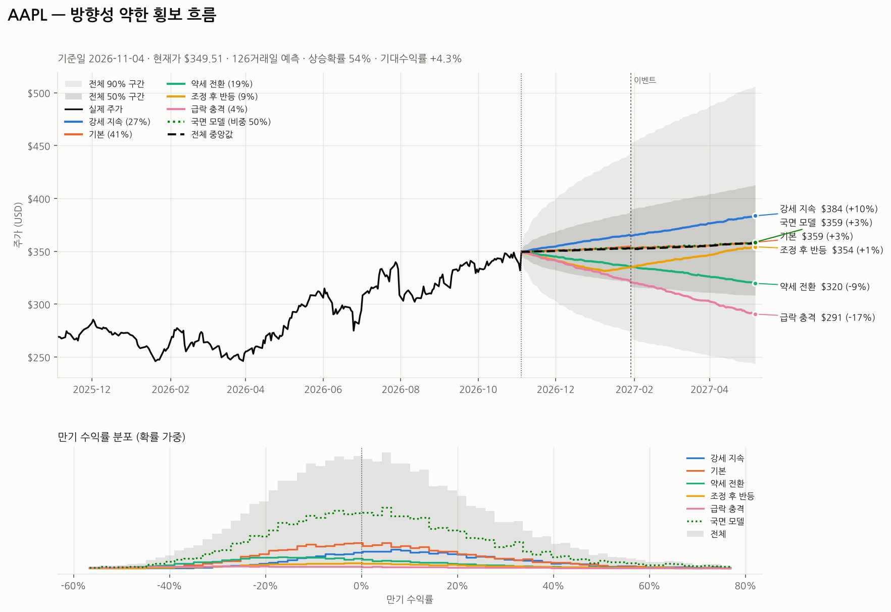
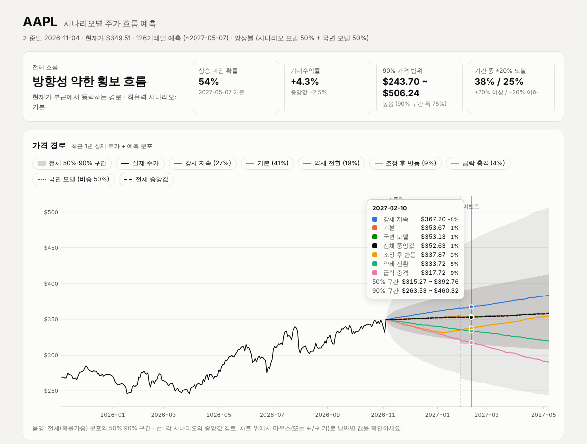
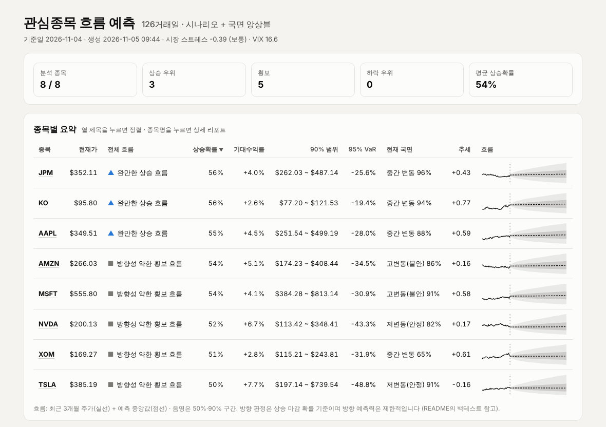

# STk — 미국 개별주 시나리오별 주가 흐름 예측

미국 단일 종목(AAPL, NVDA, TSLA …)의 **향후 주가 흐름**(방향, 경로 모양, 변동 범위, 국면 전환)을
확률적으로 예측하는 프로그램입니다.

- **시나리오 모델**: 강세 / 기본 / 약세 / 조정 후 반등 / 급락 시나리오를 종목별로 자동 보정하고 확률을 배정
- **국면(HMM) 모델**: 과거 수익률에서 저변동·중간·고변동 국면을 데이터로 찾아내고, 국면 전환을 시뮬레이션
- **시장 환경**: VIX·VIX 기간구조·S&P500 낙폭으로 선행 변동성과 시장 스트레스를 반영
- **이벤트**: 실적 발표일 등 특정 날짜의 급등락 충격 반영
- **목표가·손절가 / 위험 지표**: 도달 확률, 어느 쪽에 먼저 닿을지, 도달 시점, VaR·CVaR·최대낙폭
- **관심종목 대시보드**: 여러 종목을 병렬로 예측해 정렬 가능한 한 페이지로 요약
- **예측 기록 · 실전 성과 추적**: 모든 예측을 자동 기록하고, 날짜가 지나면 실제 주가와 비교해 적중률을 집계
- **자동 실행 (GitHub Actions)**: 평일 장 마감 후 관심종목 20개를 1개월·6개월로 예측해 사이트·기록을 `forecast-reports` 브랜치에 게시, 흐름 변화 이슈 알림(선택), CI로 테스트 자동 검증
- **요약 해설**: 흐름·범위·국면·시장·섹터·실적일을 한국어 문장으로 정리
- **섹터 분석**: 가장 잘 맞는 섹터 ETF 자동 판별, 위험을 시장·섹터·종목 고유 몫으로 분해, 섹터 대비 상대 강도
- **실적 발표일 추정**: 가격·거래량 패턴으로 다음 실적 발표일과 그날의 변동 폭을 추정 (표시, 선택적으로 시뮬레이션 반영)
- **데이터 점검**: 오래된 데이터·공백·튀는 체결가·짧은 이력을 자동으로 경고
- **백테스트**: 과거 시점마다 그때 데이터만으로 예측해 정확도·보정 상태를 검증, 모델 설정 비교
- **리포트**: 콘솔 · 대화형 HTML · PNG 차트 · 마크다운 · JSON

**공개 사이트: https://mingue0425-sys.github.io/STk/** (평일 매일 자동 갱신)



## 설치

```bash
pip install -r requirements.txt        # numpy, pandas, requests, matplotlib
# 또는:  pip install -e .   →  stk AAPL
```

Python 3.10 이상. 시세(종목, SPY, VIX, VIX3M, 13주 T-bill)는 Yahoo Finance에서 내려받아 `~/.cache/stk/` 에 12시간 캐시합니다.

## 빠른 시작

```bash
python -m stk AAPL                         # 6개월(126거래일) 예측
python -m stk NVDA -H 1y                   # 1년 예측
python -m stk AAPL MSFT NVDA TSLA -H 3m    # 여러 종목 + 비교표
python -m stk AAPL --event 2027-01-29      # 실적 발표일 충격 반영 (크기는 과거 데이터로 추정)
python -m stk AAPL --event 2027-01-29:8%   # 충격 크기 직접 지정 (하루 표준편차 8%)
python -m stk NVDA --target 15% --stop 10% # 목표가(+15%)·손절가(−10%) 도달 확률 분석
python -m stk TSLA --target 450 --stop 330 # 가격으로 지정해도 됨
python -m stk watch AAPL MSFT NVDA TSLA    # 관심종목 병렬 예측 → output/watch/index.html 대시보드
python -m stk watch --file watchlist.txt   # 종목 목록 파일 사용
python -m stk track                        # 지난 예측들을 실제 주가와 비교 (실전 성과)
python -m stk publish --file watchlist.txt # 1개월·6개월 사이트 생성 (site/index.html) — 자동 실행이 쓰는 명령
python -m stk NVDA --auto-events           # 추정 실적 발표일 충격을 시뮬레이션에 반영
python -m stk backtest AAPL -H 3m          # 과거 시점별 예측 정확도 평가
python -m stk backtest AAPL --compare      # 모델 설정별 성능 비교 (종목 특성 이해용)
python -m stk scenarios > my.json          # 시나리오 설정 내보내기 → 수정 → --scenarios my.json
```

실행하면 콘솔에 리포트가 출력되고 `output/` 폴더에 **대화형 HTML 리포트**, 차트(PNG), 마크다운(MD), 전체 결과(JSON)가 저장됩니다.

### HTML 리포트

브라우저로 여는 단일 파일입니다 (인터넷 연결 불필요). 가격 경로 차트에 마우스를 올리거나 ←/→ 키를 누르면
날짜별 시나리오 가격과 분포 구간이 표시되고, 범례를 눌러 계열을 켜고 끌 수 있습니다. 라이트/다크 모드를 자동으로 따릅니다.



### 목표가 / 손절가 분석

`--target`, `--stop` 으로 가격(예: `450`) 또는 현재가 대비 %(예: 목표가 `15%` = +15%, 손절가 `10%` = −10%)를 지정하면
시뮬레이션된 모든 경로를 따라가며 계산합니다.

```
■ 목표가 / 손절가 분석
   구분    가격    현재가 대비  도달(장중/종가)  만기 유지  도달 시점(중앙)  1주  1개월  3개월  6개월
  목표가  $230.15       +15.0%        67% / 64%        35%         29거래일   3%    25%    53%    67%
  손절가  $180.12       -10.0%        71% / 67%        36%         20거래일   8%    37%    60%    71%
  ▶ 목표가 $230.15 먼저 도달 45%  ·  손절가 $180.12 먼저 도달 55%  ·  기간 내 둘 다 미도달 0%  (장중 기준)
```

- **도달 (장중 / 종가)**: 예측 기간 안에 한 번이라도 그 가격에 닿을 확률. *장중*은 하루 종가와 다음 종가 사이에
  가격이 수준을 건드렸을 확률(브라운 브리지 공식 `exp(−2·a·b/σ²)`)까지 더한 값으로, 지정가·손절 주문이 실제로 체결되는
  기준에 가깝습니다. *종가*는 종가로만 판정한 값입니다. 체크포인트별 수치와 '먼저 도달'은 장중 기준입니다.
- **만기 유지**: 만기 종가가 목표가 이상(손절가는 이하)일 확률 — 보통 '도달' 확률의 절반 정도입니다
- **먼저 도달**: 목표가와 손절가 중 어느 쪽에 먼저 닿는지 (매매 계획의 손익비 판단에 유용)

모든 예측에는 **위험 지표**(95% VaR·CVaR, 손실 10%/20% 이상 확률, 경로 중 최대낙폭 분포)도 함께 표시됩니다.

### 관심종목 대시보드

```bash
python -m stk watch AAPL MSFT NVDA TSLA KO JPM -H 6m
python -m stk watch --file watchlist.txt --jobs 4
```

종목들을 CPU 코어 수만큼 병렬로 예측해 `output/watch/index.html` 에 요약 대시보드를, 같은 폴더에 종목별 HTML 리포트와
`summary.md`(GitHub용 요약)·`summary.json` 을 저장합니다. 표의 열 제목을 누르면 정렬되고, 종목명을 누르면 상세 리포트로 이동합니다.
종목 목록 파일(`watchlist.txt`)은 한 줄에 하나 또는 쉼표로 구분하며 `#` 뒤는 주석입니다.

- **직전 대비**: 예측 기록에서 같은 종목·기간·모델의 직전 예측을 찾아 상승확률 변화(▲/▼ %p)를 보여주고, 흐름 판정이
  바뀐 종목에 '흐름 변화' 표시를 붙입니다 (경계값 부근의 1%p 흔들림은 무시: 상승확률이 2%p 이상 움직였을 때만). 국면이 바뀌면 ↺ 표시.
- **실전 성과 카드**: 기록된 과거 예측 중 날짜가 지난 것들의 구간 적중률·방향 적중률
- **데이터 경고(⚠)**: 데이터 점검에서 문제가 발견된 종목



### 예측 기록과 실전 성과 추적

`forecast`·`watch` 로 예측할 때마다 체크포인트(1주·1개월·3개월…)별 예측 분포가
`~/.local/share/stk/forecasts.jsonl` 에 자동으로 기록됩니다 (`--log 파일` 로 위치 변경, 환경변수 `STK_LOG`, `--no-log` 로 끄기).
같은 종목·기준일·기간·모델로 다시 예측하면 기록이 교체됩니다.

```bash
python -m stk track                  # 날짜가 지난 체크포인트를 실제 주가와 비교
python -m stk track --csv-out eval.csv
```

50%/90% 구간 적중률, PIT, 만기 방향 적중률을 집계합니다. 백테스트가 '과거 데이터로 재현한 성적'이라면,
이것은 **실제로 예측해 둔 것이 맞았는지**를 보여주는 실전 성적표입니다. 수정주가는 배당 때마다 과거 값이 다시 조정되므로,
실제 수익률은 현재 시점의 수정주가 시계열에서 기준일 대비 비율로 계산합니다.

> 매일(또는 매주) `watch` 를 자동 실행해 두면 기록이 쌓여 실전 적중률을 확인할 수 있습니다.
> 가장 쉬운 방법은 아래 GitHub Actions 자동 실행이고, 내 PC에서는 crontab 으로도 됩니다:
> `30 7 * * 2-6 cd ~/STk && python -m stk watch --file watchlist.txt`

### 요약 해설 · 섹터 분석 · 실적 발표일 추정

모든 리포트 맨 앞에 숫자를 문장으로 풀어 쓴 **요약 해설**이 붙습니다 (규칙 기반, 수치는 모두 예측 결과에서 가져옴).

```
■ 요약 해설
  NVDA의 향후 6개월 흐름은 '방향성 약한 횡보 흐름'으로 보입니다. 상승 마감 확률 52%, 기대수익률 +6.3%이며 ...
  현재 '저변동(안정)' 국면일 가능성이 82%로 비교적 안정적인 시기이며, 6개월 뒤에는 안정 국면 확률 65% ...
  다음 실적 발표는 11월 23일 전후(±2거래일)로 추정됩니다. 과거 실적 반응일의 하루 변동이 ±8% 안팎이었으니 ...
  기술 섹터(XLK)와 어느 정도 함께 움직이며, 주가 변동은 시장 45% · 섹터 15% · 종목 고유 40%로 나뉩니다.

■ 섹터 분석
  섹터 기술(XLK)  |  연관도 0.52
  위험 분해  시장 45% · 섹터 15% · 종목 고유 40%  (β 시장 1.75, 섹터 1.31)
  섹터 대비 상대 수익률  3개월 -3.9% · 6개월 -7.5%  |  섹터 3개월 -4.7% · 섹터 추세 상승 추세
```

- **섹터 분석**: 종목과 SPDR 섹터 ETF 11개의 수익률에서 S&P500 영향을 뺀 뒤 상관이 가장 높은 ETF를 섹터로 판별하고,
  `r = α + β시장·r_SPY + β섹터·(섹터 잔차) + ε` 로 분산을 시장·섹터·종목 고유 몫으로 나눕니다. AAPL·MSFT처럼 지수 비중이 너무 커서
  시장 영향을 빼면 섹터 신호가 거의 남지 않는 초대형주는 '연관 약함'으로 표시합니다. (`--no-sector` 로 끔)
- **실적 발표일 추정**: 실적 발표 다음 날에는 '시장 대비 비정상 거래량'과 '종목 고유의 큰 움직임'이 함께 나타나고, 회사는 해마다
  비슷한 시기에 발표합니다. 과거 8년의 분기별 패턴(최근 4년 가중)으로 다음 발표일·날짜 불확실성(±거래일)·하루 충격 크기를 추정합니다.
  과거 데이터로만 예측한 다음 분기 발표일을 실제와 비교하면 16개 종목 대부분에서 **중앙 오차 1~4일, ±7일 이내 75~100%**였습니다.
  패턴이 뚜렷하지 않은 종목(V, KO, XOM 등)은 추정하지 않습니다.
- **시뮬레이션 반영은 기본으로 끕니다**: 추정 실적일 충격을 넣고 그만큼 평상시 변동성에서 실적일을 뺀 모델을 백테스트했더니
  (10개 종목, 1개월 590회 · 3개월 570회) CRPS가 1개월 +0.14%(t=0.94), 3개월 +0.31%(t=1.88)로 **개선되지 않았습니다**.
  그래서 추정 실적일은 리포트·대시보드에 **정보로만 표시**하고, `--auto-events` 를 주면 시뮬레이션에도 반영합니다.

## 자동 실행 (GitHub Actions)

저장소에 워크플로 두 개가 들어 있습니다.

| 워크플로 | 언제 | 하는 일 |
|---|---|---|
| `CI` (`.github/workflows/ci.yml`) | 코드 push · PR | Python 3.10~3.13 테스트 + ruff 린트 (네트워크 없이 합성 데이터) |
| `Daily forecast` (`.github/workflows/daily-forecast.yml`) | 평일 22:17 UTC (한국 07:17) + 수동 실행 | `watchlist.txt` 종목을 1개월·6개월로 예측 → 사이트·기록을 `forecast-reports` 브랜치에 커밋 |

**Daily forecast 가 만드는 것** (`forecast-reports` 브랜치 — 코드 브랜치에는 아무것도 커밋하지 않습니다):

```
index.html             첫 화면: 기간별 요약 카드(상승/횡보/하락 종목 수, 흐름 변화, 실전 성과) → 기간별 대시보드로 이동
README.md              기간별 요약표 (GitHub 에서 바로 보임)
latest/1m/, latest/6m/ 기간별 대시보드(index.html) · 종목별 리포트 · summary.md/json
history/YYYY-MM-DD.md  날짜별 요약 기록
data/forecasts.jsonl   누적 예측 기록 → 날짜가 지나면 자동으로 실제 주가와 비교 (실전 성과)
alerts.md              흐름 변화·불안 국면 진입·데이터 경고가 있을 때만 생성
```

실행 화면(Actions → 실행 기록)의 **Summary** 에 요약표가 표시되고, 사이트 전체가 14일간 **Artifact** 로 첨부됩니다.

**설정 방법**

1. 관심종목은 저장소 루트의 `watchlist.txt` 를 수정해 커밋합니다. 기본 20종목: 빅테크(AAPL·MSFT·GOOGL·AMZN·META),
   반도체(NVDA·AVGO·AMD), 성장주(TSLA·NFLX), 금융·결제(V·JPM·BRK.B), 헬스케어(LLY·UNH·PFE), 소비재·유통(COST·WMT·KO), 에너지(XOM).
2. 바로 돌려 보려면: GitHub → **Actions** → **Daily forecast** → **Run workflow** (예측 기간 목록·종목을 입력할 수 있음).
3. **공개 사이트**: 매 실행 후 GitHub Pages 로 자동 갱신됩니다 → **https://mingue0425-sys.github.io/STk/**
   (Settings → Pages → Source: **Deploy from a branch**, 브랜치 `forecast-reports` / `(root)`.
   워크플로가 이 브랜치에 푸시하면 GitHub 가 알아서 다시 배포합니다. 포크한 저장소에서는 같은 설정 후 `https://<사용자명>.github.io/<저장소>/`.)
4. **흐름 변화 알림 (선택)**: **Settings → Secrets and variables → Actions → Variables → New repository variable** 에서
   이름 `STK_ALERTS`, 값 `on` 을 추가하면, 흐름 판정이 바뀌거나(상승확률 2%p 이상 변화) 불안 국면에 들어간 종목이 있을 때
   '관심종목 흐름 변화 알림' 이슈에 댓글이 달립니다 (GitHub 알림으로 메일·앱 푸시 수신). 기본은 꺼져 있습니다.
5. 예약 실행(schedule)은 **기본 브랜치에 있는 워크플로만** 동작합니다. 기본 브랜치를 바꾸면 그 브랜치에도 워크플로 파일이 있어야 합니다.
   또한 GitHub 는 60일간 활동이 없는 저장소의 예약 실행을 멈출 수 있습니다.

### 콘솔 출력 예시 (요약, AAPL 6개월 · 실적 발표일 지정)

```
모델: 앙상블 (시나리오 모델 30% + 국면 모델 70%)
이벤트: 2027-01-29 (하루 충격 ±6.4%)

■ 전체 흐름 전망
  ▶ 방향성 약한 횡보 흐름  —  현재가 부근에서 등락하는 경로
  · 상승 마감 확률 54%  |  기대수익률 +4.4%  |  중앙값 수익률 +2.5%
  · 만기 90% 범위 $244.74 ~ $508.26  |  변동성 높음 (90% 구간 폭 75%)
  · 기간 중 +20% 도달 확률 38%  |  −20% 도달 확률 25%  |  최유력 시나리오: 기본

■ 시장 환경
  시장 스트레스 -0.39 (보통)  |  VIX 16.6 (5년 백분위 39%)  |  VIX/VIX3M 0.88 (정상(우상향))  |  S&P500 고점 대비 -1.6%
  변동성 반영  과거 EWMA 27.7% + VIX 기반 선행 27.1% → 출발 변동성 27.4% (장기 26.5%로 회귀)

■ 국면 분석 (은닉 마르코프 모델, 데이터 기반)
  현재 '중간 변동' 국면일 확률 88% (평균 지속 13거래일) → 6개월 후 저변동(안정) 47% · 중간 변동 48% · 고변동(불안) 5%
    기간   저변동(안정)  중간 변동  고변동(불안)
    현재             0%        88%           12%
    1주             22%        68%           10%
    1개월           44%        50%            6%
    6개월           47%        48%            5%
```

리포트 구성:

1. **전체 흐름 전망**: 확률가중(앙상블) 분포 기준 방향 판정(뚜렷한/완만한 상승·횡보·하락), 경로 모양
   (우상향 / 조정 후 회복 / 상승 후 되돌림 등), 90% 범위, 기간 중 ±20% 도달 확률
2. **현재 상태 진단**: 추세 점수, 이동평균, RSI, 모멘텀, 변동성, 베타, 꼬리 두께
3. **시장 환경**: 시장 스트레스 점수, VIX 수준·기간구조, S&P500 낙폭, VIX 기반 선행 변동성
4. **시나리오별 결과**: 시나리오·국면 모델별 확률, 기대가격, 중앙값, 5~95% 범위, 상승확률, 경로 중 최대낙폭(MDD)
5. **국면 분석**: 현재 국면 확률, 국면별 특성(기대수익률·변동성·평균 지속기간), 기간별 국면 확률(국면 흐름)
6. **기간별 흐름**: 1주·1개월·3개월·6개월·1년 시점의 시나리오별·국면 모델 중앙값 가격과 전체 분포

## 모델 구조

```
시세 수집 ─▶ 상태 진단 ─▶ 파라미터 보정 ─┬▶ 시나리오 확률 배정 ─▶ 시나리오 몬테카를로 ─┐
(Yahoo)     (analysis)   (+시장 환경)     └▶ HMM 국면 적합 ──────▶ 국면 전환 몬테카를로 ─┴▶ 앙상블 → 흐름 판정
```

| 단계 | 내용 |
|---|---|
| 상태 진단 | 수정종가 기준 변동성(EWMA·1년·5년), 6개월/1년 로그가격 회귀 추세, 20/50/200일 이동평균, RSI(14), 12-1개월 모멘텀, SPY 대비 베타, 표준화 수익률 첨도로 추정한 꼬리 두께 |
| 추세 점수 | 200일선 위치 · 50/200일선 크로스 · 12-1 모멘텀 · 6개월 추세 t값 · RSI 역추세를 −1~+1로 정규화해 가중평균 |
| 기본 기대수익률 | CAPM = 무위험이자율(13주 T-bill) + β × 주식위험프리미엄(5%). `--trend` 시 `0.8·CAPM + 0.2·최근 추세` |
| 선행 변동성 | `σ² = β²·(VIX×0.85)² + σ_고유²` — 시장 부분은 옵션시장 기대(VIX/VIX3M), 고유 부분은 과거 데이터. 과거 EWMA와 50:50으로 섞어 출발 변동성으로 쓰고, 반감기 42거래일로 장기 변동성에 회귀 |
| 시장 스트레스 | VIX 5년 백분위(50%) · VIX/VIX3M 역전 여부(30%) · S&P500 낙폭(20%) → −1(안정)~+1(공포) |
| 시나리오 확률 | `p ∝ 사전확률 × exp(stress_tilt·스트레스·0.6 [+ tilt·추세점수·0.7, --trend 시])` — 스트레스가 높으면 급락·조정 후 반등처럼 변동이 큰 시나리오 확률↑ |
| 시나리오 시뮬레이션 | 일간 로그수익률 = (μ − ½σ²)Δt + σ√Δt·ε + 점프 (+ 이벤트 충격). ε는 Student-t(두꺼운 꼬리), 점프는 복합 포아송 |
| 국면(HMM) 모델 | 3상태 가우시안 은닉 마르코프 모델을 Baum-Welch(EM)로 적합. 마지막 날 필터링 확률 = 현재 국면, 전환행렬 거듭제곱 = 미래 국면 확률. 국면별 평균수익률은 추정 정밀도만큼 축소(경험적 베이즈)한 뒤 기본 기대수익률에 맞춤 |
| 앙상블 | 전체 분포 = 시나리오 모델 × (1 − w) + 국면 모델 × w (기본 w = 0.7) |
| 이벤트 | 지정일에 평균 0인 하루 충격 N(−½s², s²). s를 생략하면 최근 12분기 '분기 최대 일간 변동'으로 추정 |

### 기본 시나리오

| 시나리오 | 사전확률 | 기대수익률 | 변동성 | 추세 tilt | 스트레스 tilt |
|---|---:|---|---:|---:|---:|
| 강세 지속 | 25% | 기본 + 1폭 | ×0.9 | +1 | −0.3 |
| 기본 | 40% | 기본 | ×1.0 | 0 | 0 |
| 약세 전환 | 20% | 기본 − 1.5폭 | ×1.25 | −1 | +0.3 |
| 조정 후 반등 | 10% | 앞 35%: 기본 − 2.5폭, 뒤 65%: 기본 + 1.2폭 | ×1.4 → ×1.0 | 0 | +0.6 |
| 급락 충격 | 5% | 기본 − 1폭 + 점프(연 3회, 평균 −8%) | ×1.6 | −1 | +1.0 |

시나리오 폭 = 장기 변동성의 절반 (6%~30%로 제한).

## 시나리오 직접 만들기

`python -m stk scenarios > my.json` 으로 기본 설정을 내보낸 뒤 수정해서 `--scenarios my.json` 으로 사용합니다.

```json
{
  "tilt_strength": 0.7,
  "stress_strength": 0.6,
  "fixed_probabilities": false,
  "scenarios": [
    {
      "key": "earnings_beat",
      "name": "실적 서프라이즈",
      "description": "다음 분기 실적 호조 후 재평가",
      "prior": 0.3,
      "tilt": 0.5,
      "stress_tilt": -0.2,
      "phases": [
        {"frac": 0.2, "drift_spread": 0.0, "vol_mult": 1.0},
        {"frac": 0.8, "drift": 0.35, "vol_mult": 0.9, "jump_rate": 1, "jump_mean": 0.06, "jump_std": 0.03}
      ]
    }
  ]
}
```

| 필드 | 의미 |
|---|---|
| `prior` | 사전 확률 (합이 1이 아니어도 자동 정규화) |
| `tilt` | 추세 점수 민감도. +1 = 상승 추세일 때 확률↑, −1 = 하락 추세일 때 확률↑ |
| `stress_tilt` | 시장 스트레스 민감도. + 면 시장이 불안할 때 확률↑ |
| `tilt_strength` / `stress_strength` | 위 두 효과의 전체 강도 |
| `fixed_probabilities` | `true` 면 추세·스트레스로 확률을 조정하지 않고 `prior` 그대로 사용 |
| `phases[].frac` | 예측 기간 중 이 국면이 차지하는 비중 |
| `phases[].drift` | 연 기대수익률 절대값 (0.35 = 연 35%) |
| `phases[].drift_spread` | `drift` 대신 사용: 기본 기대수익률 + k × 시나리오 폭 (종목별 자동 보정) |
| `phases[].vol_mult` | 변동성 배수 |
| `phases[].jump_rate / jump_mean / jump_std` | 연간 점프 횟수 / 점프 크기(로그) 평균 / 표준편차 |

## 주요 옵션

| 옵션 | 기본값 | 설명 |
|---|---|---|
| `-H, --horizon` | `6m` | 예측 기간: `30d`, `2w`, `3m`, `6m`, `1y`, 숫자만 쓰면 거래일 |
| `-n, --sims` | 10000 | 시나리오(및 국면 모델)당 시뮬레이션 경로 수 |
| `--model` | `ensemble` | `ensemble`(시나리오+국면), `scenario`, `regime` |
| `--regime-weight` | 0.7 | 앙상블에서 국면 모델 비중 |
| `--event DATE[:SIZE]` | | 이벤트일 (여러 번 지정 가능). SIZE 예: `8%`, `0.08` |
| `--target` / `--stop` | | 목표가·손절가: 가격 또는 % (여러 번 지정 가능) |
| `--log` / `--no-log` | 자동 기록 | 예측 기록 파일 위치 / 기록 끄기 |
| `--file`, `--jobs` | | (watch) 종목 목록 파일, 병렬 작업 수 |
| `--summary-md FILE` | | (watch·publish) 마크다운 요약을 파일에 덧붙임 (예: `$GITHUB_STEP_SUMMARY`) |
| `--auto-events` | 끔 | 추정 실적 발표일 충격을 시뮬레이션에 반영 (끄면 표시만) |
| `--no-sector` | | 섹터 분석 끔 (섹터 ETF 11개 다운로드 생략) |
| `--horizons`, `--site` | `1m,6m`, `site` | (publish) 예측 기간 목록, 사이트 폴더 |
| `--scenarios` | 내장 | 사용자 시나리오 JSON |
| `--trend` | 끔 | 추세 신호 사용: 추세 점수로 시나리오 확률 조정 + 기본 기대수익률에 추세 20% 반영 (아래 백테스트 참고) |
| `--trend-weight` | 0 (`--trend` 시 0.2) | 기본 기대수익률에서 최근 추세 비중 |
| `--no-stress` | | 시장 스트레스로 시나리오 확률을 조정하지 않음 |
| `--no-market` | | VIX·시장 환경 미반영 |
| `--erp` | 0.05 | 주식 위험 프리미엄 |
| `--rf` | auto | 무위험이자율 (auto = ^IRX 13주 T-bill) |
| `--benchmark` | SPY | 베타·시장 환경 기준 (`none` 이면 생략) |
| `--csv` | | 로컬 CSV 사용 (Date, Close/Adj Close 열 필요) |
| `--json` | | 리포트 대신 JSON 출력 |
| `--lang` | auto | PNG 차트 라벨 언어. 한글 글꼴(맑은 고딕, AppleGothic, 나눔고딕 등)이 없으면 영어 |
| `--refresh` / `--no-cache` | | 캐시 무시 / 캐시 미사용 |
| `--seed` | 42 | 난수 시드 (같은 시드 = 같은 결과) |

## 백테스트 (예측 신뢰도 점검)

```bash
python -m stk backtest AAPL -H 3m --step 21 --eval-years 5
python -m stk backtest AAPL -H 3m --compare
```

과거 각 시점에서 **그 시점까지의 데이터만으로**(가격·VIX·금리 모두) 예측한 뒤 실제 결과와 비교합니다.

- **50% / 90% 구간 적중률**: 실제 가격이 예측 구간 안에 들어온 비율. 각각 50%, 90%에 가까울수록 변동 범위 예측이 정확
- **방향 적중률, Brier 점수**: 상승확률 예측의 정확도
- **PIT 분포**: 고르게 퍼질수록 분포 전체가 잘 보정된 것
- **CRPS skill**: 기대수익률 0인 단순 랜덤워크 대비 개선율 (양수면 기준보다 나음)

### 모델 선택 근거 (10개 종목 워크포워드 실험)

AAPL, MSFT, JPM, XOM, KO, TSLA, NVDA, AMZN, PFE, INTC — 최근 5년, 21거래일 간격, 종목 평균. 각 칸은 **3개월 / 6개월** 예측 결과입니다.

| 설정 | CRPS skill | 90% 적중 | 50% 적중 | 방향 적중 | 기대-실현 상관 |
|---|---:|---:|---:|---:|---:|
| v0.1 시나리오 + 추세 (구 기본값) | +3.0% / +6.0% | 93% / 93% | 57% / 55% | 56% / 57% | −0.09 / −0.12 |
| 시나리오 + 추세 + 시장 환경 | +3.3% / +6.0% | 94% / 93% | 58% / 56% | 56% / 58% | −0.08 / −0.11 |
| 시나리오 (추세 제외) | +3.4% / +6.6% | 95% / 94% | 56% / 57% | 59% / 61% | +0.15 / +0.23 |
| 앙상블 50% + 추세 | +4.5% / +7.4% | 93% / 92% | 54% / 53% | 58% / 59% | −0.06 / −0.11 |
| 앙상블 50% (추세 제외) | +4.7% / +8.0% | 93% / 93% | 54% / 54% | 58% / 63% | +0.12 / +0.17 |
| **앙상블 70% (추세 제외) — 기본값** | **+5.0% / +8.3%** | 93% / 92% | 53% / 52% | 59% / 63% | +0.14 / +0.18 |
| 국면(HMM) 단독 (추세 제외) | +5.3% / +8.6% | 91% / 90% | 51% / 49% | 59% / 62% | +0.12 / +0.16 |

해석:

- **국면(HMM) 모델 비중을 높일수록 정확도가 오릅니다** (CRPS skill +3.0% → +5.0%, 6개월 +6.0% → +8.3%).
  국면 모델 단독이 수치상 가장 좋지만 차이는 0.3%p 정도이고, 기본값은 시나리오별 해석을 함께 담기 위해 앙상블(국면 70%)로 두었습니다.
  순수하게 통계적 정확도만 원하면 `--model regime` 을 쓰세요.
- **추세 신호는 평균적으로 방향 예측을 악화**시켰습니다 (기대-실현 상관이 음수로 바뀜). 그래서 기본값에서 껐고, `--trend` 로 켤 수 있습니다.
- **시장 스트레스에 따른 확률 조정은 정확도에 중립**이었습니다 (따로 비교한 결과 차이 ±0.1%p). 위기 시 급락·조정 시나리오
  확률을 높여 보여주는 해석상 이점이 있어 기본으로 켜 두었습니다 (`--no-stress` 로 끌 수 있음).
- 단순 랜덤워크 대비 개선은 대부분 **변동성·꼬리·국면 구조를 더 잘 맞춘 데서** 나옵니다. 방향 예측력은 여전히 제한적이므로,
  "어디로 갈지"보다 "**어느 범위에서, 어떤 국면으로 움직일 가능성이 큰지**"를 보는 도구로 쓰는 것이 맞습니다.
- 표본이 작고(대형주 10개, 현재 생존 종목), 예측 구간이 겹쳐 있어 통계적으로 확정적인 결론은 아닙니다.

### 종목별 자동 최적화는 왜 넣지 않았나

종목마다 과거 성적이 좋은 모델에 비중을 더 주는 '적응형 앙상블'도 실험했습니다. 각 시점에서 **그때까지 결과가 확정된 예측들의
성적만으로** 구성요소(시나리오/국면 × 추세 끔/켬) 비중을 정하고, 다음 예측의 정확도를 측정했습니다 (10개 종목, 1,110회).

| 방식 | 3개월 CRPS (기본값 대비) | 6개월 CRPS (기본값 대비) |
|---|---:|---:|
| 고정 기본값 (시나리오 30% + 국면 70%) | — | — |
| 국면 모델 단독 | −0.19% (유의하지 않음) | −0.06% |
| 과거 성적 기반 지수 가중 (강도별) | +0.02% ~ +0.85% | +0.09% ~ +1.42% |
| 종목별 과거 최고 설정 선택 | **+1.29% (악화, t=3.5)** | **+1.42% (악화, t=3.5)** |

사후적으로 보면 종목마다 '최고' 설정이 달랐지만(예: JPM·KO는 추세 켬, AAPL·MSFT·TSLA는 추세 끔), **과거 우위는 다음 기간에
이어지지 않았고 이를 따라가면 오히려 예측이 나빠졌습니다.** 그래서 모든 종목에 같은 기본값을 쓰고, `backtest --compare` 는
설정을 고르는 용도가 아니라 종목 특성을 이해하는 참고용으로 둡니다.

### 분포 폭 보정 실험

백테스트에서 50% 구간 적중률이 53%·90% 구간이 92~93%로 예측 분포가 약간 넓게 나와, 분포 폭에 보정 계수 k(0.80~1.06)를 곱하는
방법을 시험했습니다. 기간의 앞 절반에서 고른 k를 뒤 절반에 적용하면 오히려 CRPS가 0.17~0.59% 나빠졌고(최적 k가 앞 절반 1.03~1.06,
뒤 절반 0.90으로 뒤집힘), 종목 하나씩 빼고 고르는 교차검증도 평균 −0.03%/+0.45%로 개선이 없었습니다. **현재 폭(k=1)을 유지**합니다.

## 한계와 주의사항

- 가격·VIX 통계와 가정된 시나리오만 사용합니다. **실적 내용, 뉴스, 밸류에이션은 직접 반영하지 않습니다.**
  알고 있는 이벤트는 `--event` 로, 구체적인 전망은 사용자 시나리오(JSON)로 넣는 것을 권장합니다.
- 국면 모델은 과거에 반복된 변동성 패턴을 학습할 뿐, 처음 보는 유형의 충격을 예측하지 못합니다.
- 시나리오 확률의 추세·스트레스 조정은 휴리스틱입니다. 기본값은 위 백테스트로 정했습니다.
- 목표가·손절가의 장중 도달 확률은 종가 사이를 브라운 운동으로 근사한 값입니다. 장 시작 갭(전일 대비 급등락 출발)이나
  장중 변동성이 종가 기준 변동성과 다른 경우 실제와 차이가 날 수 있습니다.
- 장중에 실행하면 마지막 값은 당일 현재가입니다. NYSE 임시 휴장일은 거래일 계산에 반영하지 않습니다.
- **투자 권유가 아니며, 투자 판단의 책임은 본인에게 있습니다.**

## 프로젝트 구조

```
stk/
  data.py         시세 수집(Yahoo Finance), 캐시, CSV 로드, 무위험이자율
  analysis.py     변동성·추세·모멘텀·베타·꼬리 두께·추세 점수·이벤트 충격 크기
  market.py       시장 환경: VIX/VIX3M/SPY → 스트레스 점수, 선행 변동성
  scenarios.py    시나리오 정의/보정/확률 배정 (기본 시나리오 포함)
  simulation.py   시나리오 몬테카를로 (국면 전환, 변동성 회귀, t-분포, 점프, 이벤트)
  regime.py       가우시안 HMM (Baum-Welch), 현재 국면, 국면 전환 몬테카를로
  forecast.py     파이프라인, 앙상블, 체크포인트, 전체 흐름 판정
  report.py       콘솔/마크다운/JSON 리포트
  html_report.py  대화형 HTML 리포트 (단일 파일)
  plotting.py     팬 차트 + 만기 수익률 분포 PNG
  backtest.py     워크포워드 백테스트 (구간 적중률, PIT, Brier, CRPS), 설정 비교
  watch.py        관심종목 병렬 예측 + 대시보드 HTML
  publish.py      여러 예측 기간 사이트(첫 화면·기간별 대시보드·README·history·알림) 생성
  tracking.py     예측 기록(JSONL)과 실전 성과 추적
  earnings.py     실적 발표일 추정 (가격·거래량 패턴)
  sector.py       섹터 ETF 판별 · 위험 분해 · 상대 강도
  narrative.py    한국어 요약 해설
  cli.py          명령행 인터페이스
tests/            pytest (네트워크 없이 합성 데이터로 실행)
```

```bash
pip install pytest && python -m pytest -q
```
